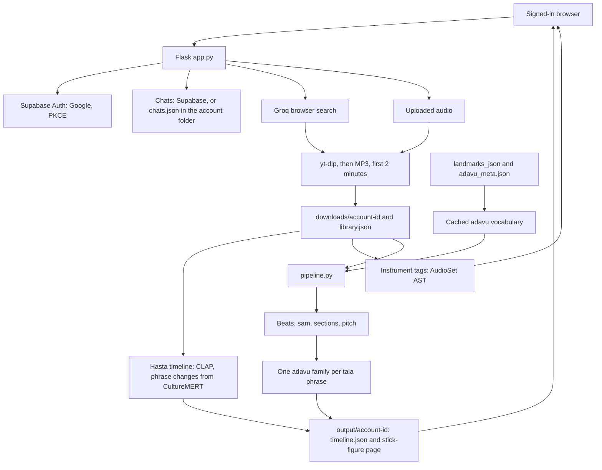

# BeatsNatyam

BeatsNatyam maps Bharatanatyam **nritta** — rhythm and tempo, not lyric meaning — onto an Indian classical recording. A prompt or an uploaded track becomes a two-minute MP3, a beat grid, a sequence of adavus, and a stick-figure player. Hasta suggestions and instrument tags sit beside the dance; they do not choose the steps.

# Initial Architecture Brainstorming

During the first two hours of the hackathon, our team collaboratively brainstormed and sketched the initial system architecture. These rough hand-drawn diagrams capture our early ideas, proposed workflows, and the direction we initially envisioned for the project.

As development progressed, we refined these ideas into the implementation architecture presented below.
# Initial Architecture Sketches

<p align="center">
  
  
</p>


## Architecture



`app.py` is the HTTP layer. `modules/` holds sign-in, chats, song search, download, storage, tala names, hastas, and instrument tags. `pipeline.py` is the command line for choreography; the web app runs that same command. The stages live in `dance/`:

| Stage | Module | What it writes |
| --- | --- | --- |
| Beats and tala | `dance/analysis.py` | `analysis.json` — beat times, sam, sections, pitch |
| Adavu cycles | `dance/cycle.py`, `dance/pose.py`, `dance/vocabulary.py` | cached vocabulary under `landmarks_json/.vocab/` |
| Phrase plan | `dance/planner.py` | which adavu, which speed, which beats |
| Player | `dance/player.py`, `dance/player.html` | `timeline.json` and `index.html` |

`adavus_extractor.py` (`extract_landmarks.py` in its own header) turns a facing-camera adavu video into one MediaPipe landmark JSON. `audio_analyzer.py` is a separate checker: it can write a click track and, if Demucs is installed, a vocal/other split. The dance pipeline itself does not call Demucs. It separates harmonic and percussive energy with librosa on the waveform.

Each Google account has one profile, its own chats, songs under `downloads/<account-id>/`, and players under `output/<account-id>/`.

## Design decisions

**Steps follow the pulse, not the lyric.** The planner never reads the words. It fills tala phrases with adavu families. Hastas are a second timeline, shown with the player, so abhinaya stays visible without being mistaken for the nritta plan.

**One pipeline for the browser and the command line.** The Flask route shells out to `pipeline.py`. The player is a static page with the timeline inlined, so the CLI result opens by double-click and the web app serves that same file only to the signed-in account.

**Only the opening two minutes are danced.** `ffmpeg` keeps the first 120 seconds. The song prompt tells Groq the same limit, so a recommendation is judged on the stretch that will actually be planned. Beat tracking and planning stay bounded.

**A known tala name beats the model’s beat count.** Groq often pairs a right name with a wrong number (`Khanda Chapu (7 beats)`, `Ata (4 beats)`). `modules/tala.py` maps the name — Adi 8, Rupaka 6, Misra Chapu 7, Ata 14, and the other names in that table — and uses the model’s count only when the name is unknown. A prompt with no named tala is Adi, 8 beats.

**The beat grid is repaired before any step is placed.** `beat_this` is used when it loads, because it returns downbeats; otherwise librosa beat tracking is used and the sam is only a guess from onset strength. A hole larger than 1.8 times the median beat is filled at that tempo, so a missed beat does not play one adavu in slow motion. A beat closer than 0.55 of the median is dropped as a tracker glitch, except the final beat. `--sam-beat N` overrides the grid when the click accent is not on the sam.

**Adavu length is counted by hand.** `landmarks_json/adavu_meta.json` is the source for beats in one repetition, and for `period_s`, `start_s`, and `end_s` when the automatic cycle is wrong. Clips start at 4 beats with `"checked": false`. The vocabulary cache rebuilds only when a clip, that file, `--clip-bpm`, or the vocabulary code changes.

**A phrase is tiled, then varied.** These rules are hard, not preferences:

- An adavu is placed whole. Its beats must divide the phrase.
- One phrase holds one family and repeats it, the way a class fills an avartanam. The next phrase changes family. Clips that share a sollukattu (ta tei tei ta and paraval, for example) are one family.
- Speeds are 1, 2, and 4. Nothing shorter than 1.25 seconds is allowed. Floor work and long travelling steps have a lower speed ceiling; tatta, natta, mettu, and the smaller rhythmic steps may go faster.
- The piece ends on a teermanam when one fits the closing phrase. The first phrase prefers tatta, the second natta.
- If a new family cannot tile a phrase, the previous family is repeated. A tail that nothing can tile holds the final pose.

Onset density chooses the preferred speed. Harmonic versus percussive balance, and the pallavi / anupallavi / charanam labels, only bias which family is cheaper. Those labels are unsupervised clusters of tala cycles, named in order. They are a structural hint, not a parse of the composition.

**The body travels; the joints do not invert.** Bone angles shape the pose. Stage travel comes from image landmarks: the hip for sideways movement, the lower foot for jumps. World landmarks are centred on the hips, so they are not used for travel. Cycles are stored so they end where they start. Comparing those resting poses made two similar stances alternate for a whole song, so the planner does not do that. It scores the join from the end of one cycle to the start of the next, and it penalises a path that walks off the stage. Knees and elbows are clamped to hinge limits so a bad landmark cannot hyperextend a joint.

**Hastas change on the music, and the names stay in a file.** CLAP ranks each 10-second window against a short audible description of every hasta. CultureMERT only marks a phrase change, where a smaller lead is enough to switch. `modules/mudhra_keys.json` is the number and name source of truth. Photographs are the numbered set `1.png`–`52.png`.

**Instrument names are a map, not a Carnatic classifier.** A 10-second window around the playhead goes through an AudioSet AST model. AudioSet labels are then renamed to the nearest Carnatic or Hindustani instrument (drum to mridangam, drone to tanpura, and so on). The model loads on the first request so the app can start without it.

**Accounts do not share files.** Google sign-in uses Supabase Auth with PKCE. The service role key stays on the server and bypasses row level security; the anon key is not used, and RLS stays on. Song and dance URLs are checked against the signed-in account id. If Supabase tables are missing, chats fall back to `downloads/<account-id>/chats.json`. If Groq returns no usable YouTube link, a song already in `downloads/` is copied into the account and danced instead.

## Setup

Python 3.14 or newer, [uv](https://docs.astral.sh/uv/), and `ffmpeg` (uploads that are not already MP3 are converted, and tracks longer than two minutes are trimmed). `ffprobe` is used when a duration check is needed.

```bash
uv sync
```

Add this to `.env` in this folder:

```bash
GROQ_API_KEY="your-groq-api-key"
SUPABASE_URL="https://YOUR-PROJECT.supabase.co"
SUPABASE_SERVICE_ROLE_KEY="your-service-role-key"
```

`GROQ_API_KEY` is required for song search. Uploading your own audio does not call Groq. The default model is `openai/gpt-oss-20b` with Groq browser search.

### Supabase and Google sign-in

1. Create a Supabase project.
2. Open **SQL Editor**, paste `supabase/schema.sql`, and run it. That creates `profiles`, `chats`, and `chat_turns`, adds `chats.user_id`, and turns on row level security. Run it again if the project was created before accounts existed.
3. Open **Project Settings → API** and copy the project URL and the **service_role** key. That key bypasses row level security. Keep it on the server only. Do not put it in the browser, and do not commit it.
4. Open **Authentication → Sign In / Providers → Google** and turn Google on. In Google Cloud, create a web OAuth client whose redirect URI is `https://YOUR-PROJECT.supabase.co/auth/v1/callback`, then paste that client id and secret into Supabase. Under **Authentication → URL Configuration**, allow `http://127.0.0.1:6767/auth/callback` (and the same URL with `localhost` if you open the app that way).

Restart `uv run app.py`. The sidebar note disappears once the app is talking to Supabase. Each prompt is appended to the open chat. **New chat** starts another thread. Opening a dance keeps that prompt at the top of the dance screen.

## Run

Web app:

```bash
uv run app.py
```

Open [http://127.0.0.1:6767](http://127.0.0.1:6767). Sign in with Google, then enter a prompt or upload audio. The account’s songs are listed from its own `library.json`.

Song search from the command line, without building a dance:

```bash
uv run cloud_llm.py "Energetic Adi tala Carnatic song for Thattadavu" -o downloads
```

Dance from a file you already have:

```bash
uv run pipeline.py downloads/<your-song>.mp3 --adavus landmarks_json -o output --tala 8
```

Open `output/index.html` in a browser. If the accent of the beat clicks is not on the sam, rerun with `--sam-beat N`, where N is the index of a beat that is a sam.

Landmark extraction from adavu videos (one dancer, whole body, facing the camera):

```bash
uv run adavus_extractor.py /path/to/adavu_videos -o landmarks_json
```

The video file name, without the extension, becomes the adavu name.

## AI code disclosure

Parts of this repository, including application code, were drafted with AI coding assistance in Cursor. The choreography rules, tala table, and adavu lengths above are the project’s own decisions and remain the source of truth. Song recommendations, hasta labels, section names, and instrument tags are model suggestions. They are not a substitute for a teacher or a notated composition.
